<!-- ========================= BANNER ========================= -->

  

  

  
  <a href="mailto:brunoferreira5299@hotmail.com">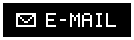</a>
  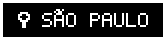

 

<!-- ========================= SOBRE MIM ========================= -->

<!-- ========================= FICHA ========================= -->
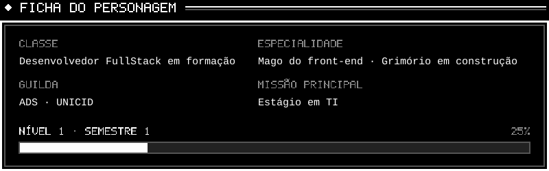

<!-- ========================= MAPA ========================= -->

<!-- ========================= ATRIBUTOS ========================= -->
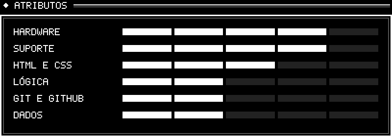

<!-- ========================= CONQUISTAS ========================= -->
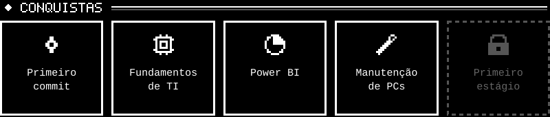

<!-- ========================= INVENTÁRIO ========================= -->
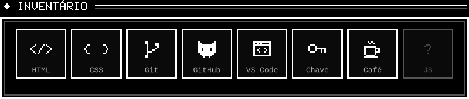

<!-- ========================= MISSÕES ========================= -->

<!-- ========================= REGISTRO DE AVENTURA ========================= -->
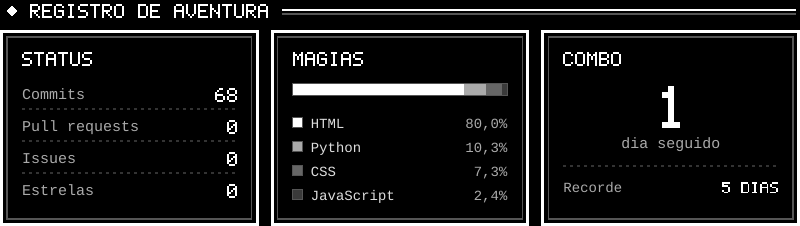

<!-- ========================= MINIGAME ========================= -->

 

<!-- ========================= CONTINUE ========================= -->

  

  
  

 

<!-- ========================= RODAPÉ ========================= -->
<!-- ========================= BANNER ========================= -->

  

  

  
  
  

 

<!-- ========================= SOBRE MIM ========================= -->

<!-- ========================= FICHA ========================= -->

<!-- ========================= MAPA ========================= -->

<!-- ========================= ATRIBUTOS ========================= -->

<!-- ========================= CONQUISTAS ========================= -->

<!-- ========================= INVENTÁRIO ========================= -->

<!-- ========================= MISSÕES ========================= -->

<!-- ========================= REGISTRO DE AVENTURA ========================= -->

<!-- ========================= MINIGAME ========================= -->

 

<!-- ========================= CONTINUE ========================= -->

  

  
  

 

<!-- ========================= RODAPÉ ========================= -->

