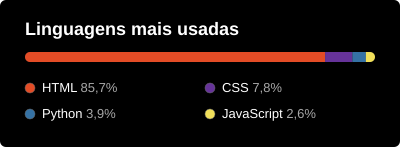

<!-- ========================= BANNER ========================= -->

  

  <!-- Frase animada -->
  
   

  <!-- Contatos -->
  
  
  

 

<!-- ========================= SOBRE MIM ========================= -->
<h1>👋 Sobre mim</h1>

Oi! Eu me chamo **Bruno Ferreira Gonçalves**, tenho 27 anos e moro em São Paulo. Passei mais de cinco anos trabalhando na área da saúde, lidando todos os dias com sistemas hospitalares, e foi no meio dessa rotina que acabei me apaixonando pela tecnologia. Resolvi seguir esse caminho e hoje curso **Análise e Desenvolvimento de Sistemas** na **UNICID**. Gosto de entender como as coisas funcionam por dentro, criar projetos do zero e aprender com cada erro pelo caminho.

Aqui no GitHub você acompanha meus projetos e a minha evolução nessa nova jornada.

- 🌱 Aprendendo e praticando todos os dias
- 🎯 Com foco em me tornar **Desenvolvedor FullStack**
- 📫 Quer conversar? Me chame no LinkedIn ou por e-mail

 

<!-- ========================= TECNOLOGIAS ========================= -->
<h1>🛠️ Tecnologias</h1>

  

<!-- Para adicionar mais: js,ts,react,nodejs,python,java,mysql,postgres,docker -->

 

<!-- ========================= ESTATÍSTICAS ========================= -->
<h1>📊 Estatísticas</h1>

  <!-- Estatísticas gerais -->
  

  <!-- Linguagens com porcentagem (inclui repositórios em que sou colaborador).
       Gerado automaticamente pelo arquivo linguagens.py e pelo GitHub Actions. -->
  
   

  <!-- Sequência de contribuições -->
  

 

<!-- ========================= RODAPÉ ========================= -->

  

